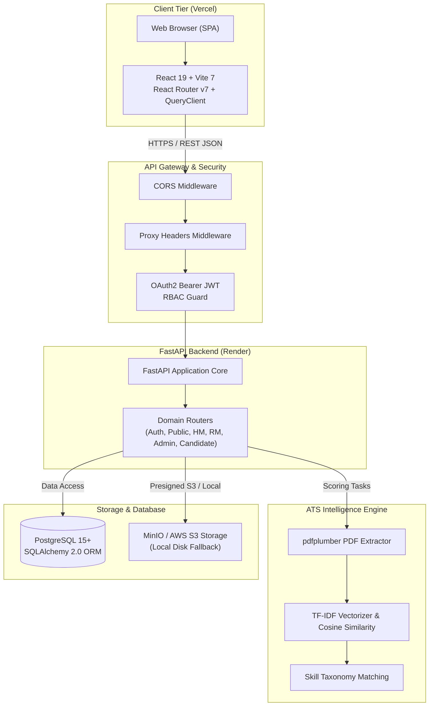

# HireStream — Enterprise Applicant Tracking System (ATS)

[](https://github.com/akshaydeepakm44/Hirestream)
[](https://hirestream.vercel.app)
[](https://hirestream-backend.onrender.com)
[](https://render.com)
[](LICENSE)

HireStream is a production-grade, enterprise **Applicant Tracking System (ATS)** and talent acquisition management platform. It automates and streamlines the recruiting lifecycle—from job requisition authoring and candidate resume ingestion to algorithmic ATS scoring via TF-IDF vectorization, multi-round interview scheduling with Google Meet, and pre-onboarding document verification.

---

## 30-Second Elevator Pitch
> *"HireStream is a full-stack Enterprise Applicant Tracking System built with FastAPI, PostgreSQL, and React 19. It solves manual resume screening bottlenecks through an automated ATS matching engine that uses TF-IDF vectorization and skill-taxonomy extraction to rank candidates against job requirements. The system enforces strict enterprise Role-Based Access Control (RBAC) across four distinct personas—Super Admins, Resource Managers, Hiring Managers, and Candidates—while handling document management through S3/MinIO and automated interview scheduling through Google Workspace integration."*

---

## Architecture Overview



---

## Key Features Across Personas

### 1. Super Admin (Platform Governance)
- **Recruiter Registration Approvals:** Review, approve, or reject incoming Hiring Manager and Resource Manager access requests.
- **Enterprise Analytics:** Platform-wide telemetry covering active companies, requisitions, candidate volume, and departmental funnel conversion rates.
- **Support Inbox:** Inspect and respond directly to inbound contact form inquiries submitted from the public landing page.

### 2. Resource Manager (Talent Acquisition & Sourcing)
- **Algorithmic ATS Matching:** Upload and parse PDF resumes using `pdfplumber`, generating automated 0–100% suitability scores based on TF-IDF cosine similarity and skill taxonomy extraction.
- **Candidate Pipeline Management:** Progress candidates across lifecycle stages: *Sourcing -> Screening -> Assessment -> Ready for HM -> Interviewing -> Offer Extended -> Onboarding*.
- **Interview Coordination:** Provision multi-round interviews with Google Meet link generation and participant notification.
- **Assessment Dispatch:** Issue technical assignments and review candidate submissions.

### 3. Hiring Manager (Team Hiring & Interviews)
- **Requisition Authoring:** Create and track job postings with target joining dates, compensation bands, required skills, and headcount budgets.
- **Interactive Interview Evaluation:** Score candidate interview rounds with criteria-based scorecards and qualitative feedback notes.
- **Hiring Decisions:** Advance qualified candidates or issue structured rejections.

### 4. Candidate Portal
- **Public Job Board:** Search and filter open opportunities by role, department, and employment type.
- **1-Click Application Flow:** Instant application submission using pre-filled profile data and resume parsing.
- **Application Status Tracking:** Live progress bar displaying current recruitment stage in real time.
- **Pre-Onboarding Document Upload:** Secure submission of identity proofs, academic records, and previous employment documents with verification tracking.

---

## Technology Stack

| Domain | Technology | Version | Purpose |
|---|---|---|---|
| **Frontend Framework** | React | 19.2.4 | Single Page Application UI |
| **Build Tool** | Vite | 7.3.1 | Bundling & HMR development server |
| **Language** | TypeScript | 5.9.3 | Static typing & interface contracts |
| **Styling** | Tailwind CSS | 4.2.1 | Modern utility-first design system |
| **Client Routing** | React Router DOM | 7.13.1 | HTML5 history client routing |
| **Server State** | TanStack Query | 5.95.2 | Asynchronous data fetching & caching |
| **Icons & Motion** | Lucide React / Framer Motion | Latest | Visual polish & accessible animations |
| **Backend Framework**| FastAPI | 0.110.0 | High-performance ASGI REST API |
| **Language** | Python | 3.11.18 | Modern asynchronous runtime |
| **ORM** | SQLAlchemy | 2.0.29 | Object-relational mapping & pooling |
| **Database** | PostgreSQL | 15+ | Relational data persistence |
| **Migrations** | Alembic | 1.13.1 | Database schema migrations |
| **Authentication** | Python-Jose / Passlib | Latest | JWT Bearer tokens & Bcrypt hashing |
| **NLP & Scoring** | Scikit-Learn / pdfplumber | Latest | TF-IDF resume matching & PDF parsing |
| **Object Storage** | MinIO / AWS S3 | Latest | Presigned document upload/download |
| **Testing** | Pytest / Pytest-Asyncio | 9.2.0 | Automated unit & integration tests |
| **Hosting (Frontend)**| Vercel | Production | Edge CDN static SPA delivery |
| **Hosting (Backend)** | Render | Production | Cloud container web service |

---

## Local Development Setup

### Prerequisites
- Node.js `20.x` or `22.x`
- Python `3.11.x`
- PostgreSQL 15+ (or Docker)

### 1. Backend Setup
```bash
cd hirestream/backend

# Create virtual environment
python -m venv .venv
source .venv/bin/activate  # On Windows: .venv\Scripts\activate

# Install dependencies
pip install -r requirements.txt

# Configure environment variables
cp ../.env.example .env

# Run FastAPI development server
uvicorn app.main:app --reload --port 8000
```
API Documentation will be live at `http://localhost:8000/docs`.

### 2. Frontend Setup
```bash
cd hirestream/frontend

# Install dependencies
npm install

# Start Vite development server
npm run dev
```
Application will be live at `http://localhost:5173`.

---

## Automated Test Execution

### Backend Tests
```bash
cd hirestream/backend
.venv/Scripts/python -m pytest -v
```
All 14 tests covering ATS scoring algorithms, authentication lifecycles, configuration resilience, and health endpoints run with 100% pass rate.

### Frontend Quality Verification
```bash
cd hirestream/frontend
npx tsc --noEmit     # TypeScript typecheck
npm run lint         # ESLint validation
npm run build        # Production bundle build
```

---

## Production Deployment

Complete step-by-step instructions are documented in the `docs/` directory:
- [Vercel Frontend Deployment Guide](docs/VERCEL_DEPLOYMENT.md)
- [Render Backend Deployment Guide](docs/RENDER_DEPLOYMENT.md)
- [Production Environment Variables Reference](docs/PRODUCTION_ENVIRONMENT_VARIABLES.md)
- [Production Deployment Checklist](docs/DEPLOYMENT_CHECKLIST.md)
- [Architecture & Technical Decisions (ADR)](docs/TECHNICAL_DECISIONS.md)
- [Comprehensive Initial Audit Report](docs/INITIAL_AUDIT.md)

---

## License

This project is licensed under the MIT License.
