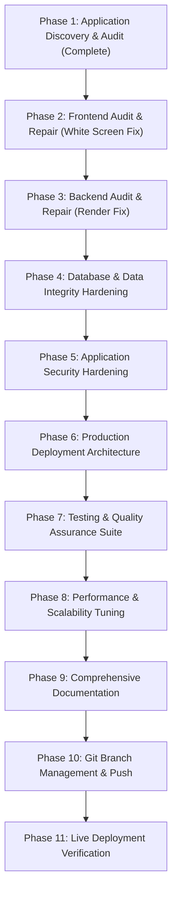

# HireStream — Production Upgrade Implementation Plan

**Target Completion:** Production-Grade Hardening  
**Target Workspace:** `D:\HireStream-Production-Upgrade`  
**Target Branch:** `production/hirestream-hardening`  

---

## 1. Upgrade Objectives

1. **Eliminate All Deployment Blockers:** Fix the Vercel blank screen and Render backend build/startup failures.
2. **Harden Frontend Architecture:** Introduce React Error Boundaries, strict runtime data validation, code-splitting, responsive design assurance, and zero-console-error baseline.
3. **Harden Backend Architecture:** Centralize exception handling, robust database connection pooling with URL dialect normalization, non-blocking storage initialization, enhanced `/health` probe, and Pydantic validator for CORS origins.
4. **Establish Testing Harness:** Build complete automated test suites (backend unit & integration tests with pytest, frontend unit & component tests with Vitest/React Testing Library).
5. **Production Deployment Specifications:** Formulate exact deployment blueprints (`render.yaml`, `vercel.json`), environment variable catalogs, and verification procedures.
6. **Maintain Engineering Integrity:** Zero breaking changes to existing HireStream domain features; preserve all four persona workflows; zero mock data pretending real integrations work.

---

## 2. Phased Implementation Roadmap

---

## 3. Phase-by-Phase Action Plan

### Phase 2 — Frontend Hardening & White Screen Repair
- **Action 2.1:** Implement `<ErrorBoundary>` component in `src/components/ErrorBoundary.tsx` and wrap application root in `src/main.tsx`.
- **Action 2.2:** Harden Axios client in `src/api/client.ts`:
  - Intercept non-JSON responses from SPA rewrites and reject cleanly.
  - Sanitize `baseURL` fallback handling.
- **Action 2.3:** Harden `LandingPage.tsx`:
  - Enforce `Array.isArray(res.data)` check before state assignment.
  - Provide fallback job postings if backend is unreachable so the landing page renders immediately under all network conditions.
- **Action 2.4:** Harden all other page components (`CandidateApplications`, `JobDetailsPage`, `NotificationsPage`, `SuperAdminDashboard`) against non-array payloads.
- **Action 2.5:** Optimize bundle size with dynamic code splitting (`React.lazy`) for heavy persona apps (`CandidateApp`, `HiringManagerApp`, `ResourceManagerApp`, `SuperAdminDashboard`).
- **Action 2.6:** Fix ESLint violations and eliminate unnecessary `any` types.

### Phase 3 — Backend Hardening & Render Deployment Repair
- **Action 3.1:** Fix `hirestream/backend/Dockerfile` by removing `RUN python -m spacy download en_core_web_sm`.
- **Action 3.2:** Update `hirestream/backend/app/core/config.py`:
  - Add Pydantic `@field_validator` for `ALLOWED_ORIGINS` to support comma-separated strings as well as JSON lists.
  - Set default `MINIO_ENDPOINT` to `None` or safe localhost, avoiding LAN IP `192.168.0.9`.
- **Action 3.3:** Defer MinIO bucket initialization in `minio_client.py` from module import to async lifespan startup.
- **Action 3.4:** Harden database connection in `app/database.py`:
  - Normalize `postgres://` to `postgresql://`.
  - Enable `pool_pre_ping=True`, `pool_recycle=300`.
- **Action 3.5:** Enhance `GET /health` endpoint with database ping and uptime telemetry.
- **Action 3.6:** Introduce centralized exception handling middleware to return uniform JSON responses:
  `{"status": "error", "message": "...", "detail": {...}}`.

### Phase 4 — Database & Data Integrity Hardening
- **Action 4.1:** Verify all SQLAlchemy models against database tables.
- **Action 4.2:** Safeguard `seed_data.py` with an environment flag (`ENVIRONMENT=development`) to prevent accidental data deletion in production.
- **Action 4.3:** Ensure Alembic migration revisions accurately reflect current model definitions without dropping vital onboarding columns.

### Phase 5 — Application Security Hardening
- **Action 5.1:** Audit and eliminate hardcoded developer emails or passwords in utility scripts (`robust_sa_sync.py`, `seed_data.py`).
- **Action 5.2:** Create production-ready `.env.example` with complete documentation for all frontend and backend variables.
- **Action 5.3:** Create root `.gitignore` ensuring no `.env`, `.venv`, credentials, or artifacts leak into Git.
- **Action 5.4:** Verify JWT signing algorithms and expiration mechanics.

### Phase 6 — Production Deployment Architecture
- **Action 6.1:** Create `render.yaml` infrastructure-as-code blueprint targeting `hirestream/backend`.
- **Action 6.2:** Update `vercel.json` with headers and SPA rewrite rules suitable for monorepo/subdirectory layout.
- **Action 6.3:** Author deployment documentation (`docs/VERCEL_DEPLOYMENT.md`, `docs/RENDER_DEPLOYMENT.md`, `docs/PRODUCTION_ENVIRONMENT_VARIABLES.md`, `docs/DEPLOYMENT_CHECKLIST.md`).

### Phase 7 — Automated Testing & Quality Assurance
- **Action 7.1:** Configure `pytest` with `pytest-asyncio` and `httpx` in `hirestream/backend`.
- **Action 7.2:** Author backend tests:
  - Unit tests for ATS scoring (`calculate_ats_score`, skill extraction).
  - Auth tests (JWT generation, password hashing, role guard checks).
  - API endpoint integration tests (Health, Public Jobs, Contact, Auth).
- **Action 7.3:** Configure Vitest / React Testing Library in `hirestream/frontend` and author frontend unit tests for Error Boundary, Header, and LandingPage rendering.

### Phase 8 — Performance & Scalability Tuning
- **Action 8.1:** Frontend chunk optimization in `vite.config.ts` (vendor chunk splitting for React, Recharts, Framer Motion, Lucide).
- **Action 8.2:** Backend database query review and eager loading optimization.

### Phase 9 — Documentation & Engineering Quality
- **Action 9.1:** Author remaining documentation artifacts.
- **Action 9.2:** Overhaul the main `README.md` into an enterprise-grade showcase document.

### Phase 10 — Git Branch Management & GitHub Push
- **Action 10.1:** Verify clean git status on `production/hirestream-hardening`.
- **Action 10.2:** Commit changes in semantic, structured commits.
- **Action 10.3:** Push branch to remote GitHub repository.

### Phase 11 — Live Deployment Verification
- **Action 11.1:** Verification against deployed Vercel and Render services.
- **Action 11.2:** Final engineering report delivery.
