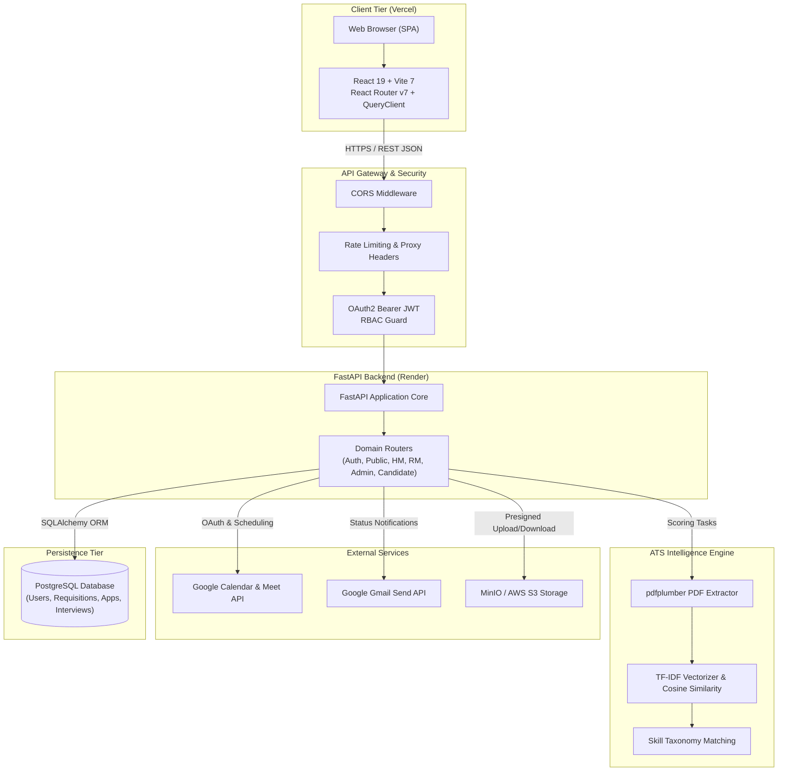
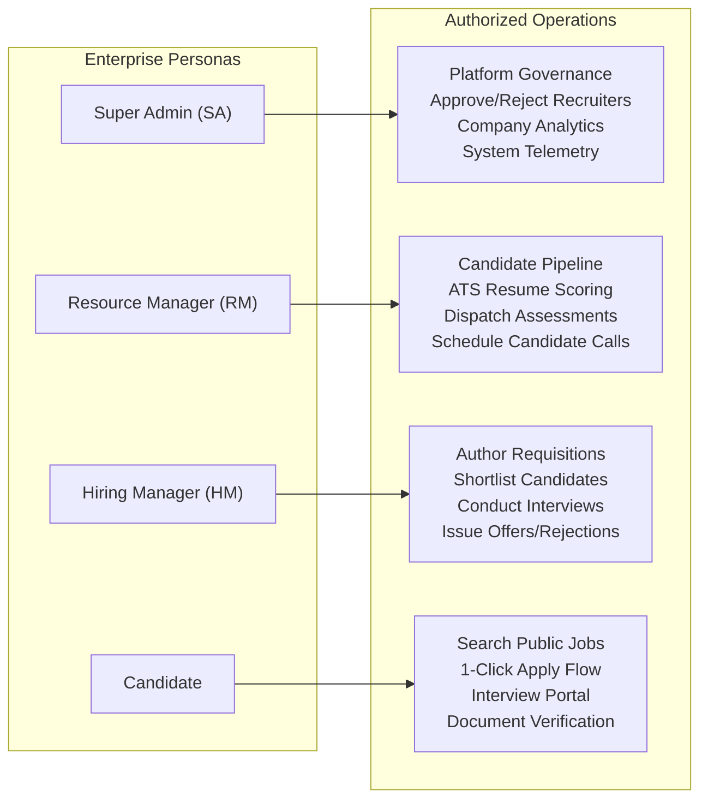
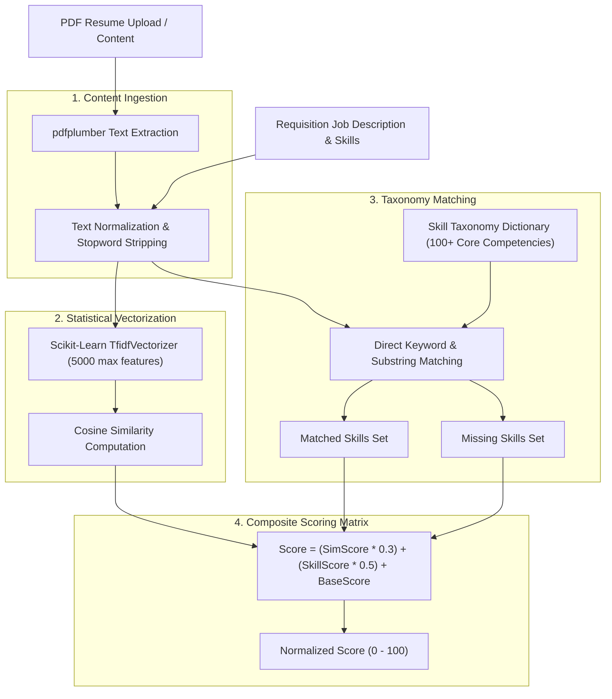

# HireStream — Complete Project Architecture

**Architecture Specification & Engineering Design**  
**Document Version:** 1.0.0 (Production Release Specification)  
**Target Environment:** Production (Vercel + Render + Cloud PostgreSQL + Object Storage)

---

## 1. System Architecture Overview

HireStream is architected as a decoupled, multi-tier enterprise web platform consisting of:
1. **Client Tier:** React 19 Single Page Application (SPA) with client-side routing, optimistic mutations via TanStack Query, and a Tailwind CSS design system.
2. **API & Business Logic Tier:** FastAPI RESTful service exposing OpenAPI 3.0 documentation, implementing strict OAuth2 Bearer JWT authentication, persona-based authorization guards, and background task processing.
3. **Intelligence & NLP Tier:** Scikit-Learn TF-IDF vectorized cosine similarity engine and PDF text extraction pipeline for algorithmic resume-to-job matching.
4. **Data Persistence Tier:** PostgreSQL 15+ relational database with SQLAlchemy 2.0 ORM and Alembic schema versioning.
5. **Object Storage Tier:** S3-compatible object storage (MinIO / AWS S3) utilizing presigned URLs for secure document ingestion with automated local filesystem fallback.
6. **External Integration Tier:** Google Workspace REST APIs for Calendar event scheduling, Google Meet room provisioning, and transactional Gmail communications.

---

## 2. High-Level Architecture Diagram



---

## 3. Persona Access Model & Role-Based Access Control (RBAC)

The system enforces strict enterprise separation of duties across 4 primary personas:



### 3.1 Persona Capabilities Matrix

| Capability | Super Admin | Resource Manager | Hiring Manager | Candidate |
|---|:---:|:---:|:---:|:---:|
| **Browse Public Job Board** | Yes | Yes | Yes | Yes |
| **Apply to Open Jobs** | No | No | No | Yes |
| **View Own Application Status** | No | No | No | Yes |
| **Upload Onboarding Docs** | No | No | No | Yes |
| **Create Job Requisitions** | Yes | Yes | Yes | No |
| **Review Candidate Pipeline** | Yes | Yes | Yes (Assigned) | No |
| **Trigger Algorithmic ATS Scan** | Yes | Yes | No | No |
| **Send Coding Assessments** | Yes | Yes | No | No |
| **Score & Feedback Interviews** | Yes | Yes | Yes | No |
| **Approve / Reject HM & RM Access**| Yes | No | No | No |
| **System-wide Metrics & Audit** | Yes | No | No | No |

---

## 4. Frontend Component & Routing Architecture

### 4.1 Route Hierarchy
```text
/                              -> LandingPage (Public Job Board + Hero + Contact)
/jobs/:id                      -> JobDetailsPage (Public Job Description & Apply Drawer)
/login                         -> Login (Candidate Authentication)
/register                      -> CandidateRegister (Candidate Self-Registration)
/forgot-password               -> ForgotPassword (Self-service recovery)
/recruiter                     -> RecruiterAccess (Overview for Employers)
/recruiter/register            -> RecruiterRegister (HM / RM Registration Request)
/hiring/login                  -> RecruiterLogin (role: hiring_manager)
/resource/login                -> RecruiterLogin (role: resource_manager)
/super-admin/login             -> SuperAdminLogin (System Administrator Entrance)

[PROTECTED: candidate]
/candidate                     -> CandidateHome (Overview & Next Actions)
/candidate/jobs                -> CandidateFindJobs (Job Board with 1-Click Apply)
/candidate/applications        -> CandidateApplications (Active Applications & Status)
/candidate/assessments         -> CandidateAssessments (Technical Assessments)
/candidate/onboarding          -> CandidateOnboarding (Document Upload & Verification)
/candidate/profile             -> ProfilePage (Candidate Master Profile)
/candidate/settings            -> CandidateSettingsPage

[PROTECTED: hiring_manager]
/hiring/dashboard              -> HiringManagerHome (Key KPIs, Upcoming Interviews)
/hiring/dashboard/requisitions -> HiringManagerRequisitions (Job Postings & Approvals)
/hiring/dashboard/pipeline     -> CandidatePipeline (Stages, Resume Review, Move Forward)
/hiring/dashboard/interviews   -> HiringManagerInterviews (Schedule, Conduct, Score)
/hiring/dashboard/analytics    -> HiringManagerAnalytics (Recruiting Funnel Metrics)

[PROTECTED: resource_manager]
/resource/dashboard            -> ResourceManagerDashboard (Talent Funnel)
/resource/dashboard/ats        -> ResourceManagerATS (Resume Parsing & TF-IDF Scoring)
/resource/dashboard/roles      -> ResourceManagerOpenRoles (Manage Active Requisitions)
/resource/dashboard/pipeline   -> ResourceManagerApplicants (Stage Management)
/resource/dashboard/interviews -> ResourceManagerInterviews (Google Meet Scheduling)
/resource/dashboard/admin      -> ResourceManagerAdministration (Candidate Profiles)

[PROTECTED: super_admin]
/super-admin/dashboard         -> SuperAdminDashboard (Approval Queue, Telemetry, Inquiries)
```

### 4.2 State & Cache Management
- **`AuthContext`:** Stores bearer token in browser `localStorage`, hydrates user entity on mount via `GET /users/me`, exposes role verification helpers and logout dispatcher.
- **`ThemeContext`:** Manages presentation mode preferences.
- **`TanStack React Query`:** Handles asynchronous server state caching, background invalidation, and deduplication of server requests.
- **Axios HTTP Client:** Injects `Authorization: Bearer <token>` automatically via interceptors and enforces URL prefixing.

---

## 5. Backend Routing & Service Layer Architecture

### 5.1 Service Layer Separation
```text
hirestream/backend/app/
├── core/
│   ├── config.py             # Pydantic v2 application settings & environment variables
│   └── security.py           # Bcrypt hashing, JWT issuance & verification
├── database.py               # SQLAlchemy engine, connection pooling, SessionLocal
├── models/                   # SQLAlchemy ORM relational models
│   ├── user.py               # User identity, roles (SA, HM, RM, Candidate), status
│   ├── requisition.py        # Job requisitions, required skills, compensation, status
│   ├── candidate.py          # Candidate biographical profiles, resumes, document paths
│   ├── application.py        # Applications, pipeline stages, ATS score, verification
│   ├── interview.py          # Multi-round interview sessions, Google Meet links, scores
│   ├── assessment.py         # Candidate online assessments and evaluation results
│   ├── notification.py       # User notification inbox
│   ├── contact.py            # Landing page public inquiry submissions
│   └── status_history.py     # Immutable audit trail of candidate status transitions
├── schemas/                  # Pydantic request/response validation schemas
├── services/                 # Pure business logic modules
│   ├── ats_service.py        # TF-IDF calculation, PDF extraction, keyword matching
│   ├── google_service.py     # Google OAuth, Calendar event scheduling, Gmail dispatch
│   ├── minio_client.py       # S3 presigned POST/GET URLs, local disk fallback
│   ├── notification_service.py # In-app notification creation
│   └── jd_service.py         # AI / template-driven job description generator
└── routers/                  # FastAPI controllers exposing REST endpoints
```

---

## 6. Algorithmic ATS Scoring Engine

The ATS evaluation engine scores candidate resumes against requisition criteria via a composite metric combining statistical term similarity and explicit skill taxonomy matching:



---

## 7. Storage Architecture & Fallback Mechanics

HireStream supports production cloud object storage (AWS S3 or MinIO) with a non-blocking fallback to local filesystem storage:
- **Presigned Uploads:** Candidates receive an S3 presigned POST policy allowing direct-to-bucket uploads without passing large binary payloads through the application server.
- **Presigned Downloads:** Document inspection generates time-limited presigned GET URLs (1-hour validity).
- **Graceful Local Fallback:** When S3/MinIO is unreachable or disabled, the storage service automatically directs uploads and downloads to `uploads/` within the backend filesystem, ensuring zero downtime even during storage maintenance.
